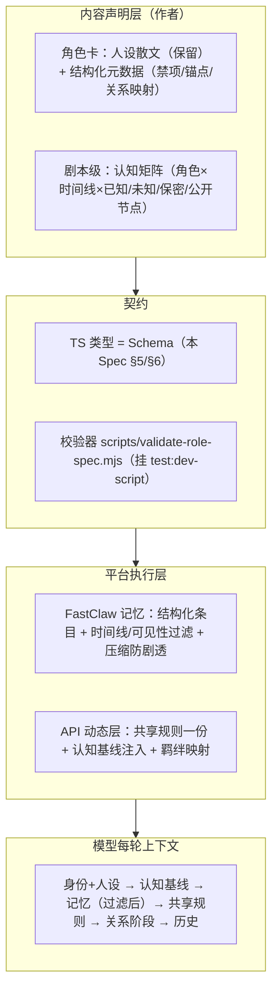

# 角色卡与记忆统一规范 Spec：文本人设 + 结构化状态 + 契约注入

日期：2026-08-15
状态：draft（2026-08-15 初稿，待复审）
修订号：0
适用版本：FastClaw 角色 Agent 架构（`docs/specs/2026-08-14-fastclaw-roleplay-agent-architecture-spec.md` revision 4）之后
变更标识：roleplay-card-memory-unified

## 1. 文档目的与冻结边界

本文档冻结「角色卡与记忆系统的统一契约」：把角色卡里**机器需要判断/过滤/校验**的内容（认知基线、禁项、剧情进度、记忆条目、关系映射）从散文抽成结构化数据，人设与表达风格保留散文；FastClaw 记忆层按契约执行「时间线 + 可见性」过滤；共享规则收敛到 API 动态层一份。

冻结边界（本文档只冻结契约与数据形态）：
- 角色卡结构化元数据：认知矩阵（剧本级）、禁项数组、锚点数组、关系映射；
- 记忆条目 Schema：类型 / 作用域 / 时间线 / 可见性 / 来源 / 内容；
- 注入协议：每轮上下文固定顺序与 `x-fastclaw-timeline` 请求头；
- 共享规则（安全 / 防剧透 / 五阶段推进 / 输出协议）收敛到 API 动态层一份。

不冻结：
- 人设散文的具体文案（`systemPrompt` / `personalityPrompt` / `scenarioPrompt` / `safetyPrompt` / `outputFormatPrompt` 的内容可迭代）；
- 记忆条目文案模板（`content` 字段可迭代）；
- 时间线推进的具体驱动方式（Phase 1 固定 `t01`，后续可由 `user_story_state` 或账本驱动，另行 Spec）；
- 模型 / temperature / maxTokens（沿用 2026-08-14 Spec §8：不动）。

## 2. 现状与证据

### 2.1 角色卡现状（代码现实）

- `character_prompts` 表 5 个字段（`systemPrompt` / `personalityPrompt` / `scenarioPrompt` / `safetyPrompt` / `outputFormatPrompt`），seed 源：`apps/api/src/server/seed/story-data.ts`。
- `scripts/provision-roleplay-agents.mjs` 把 5 字段渲染为 `SOUL.md`（五段拼接）、`IDENTITY.md`（名字/身份/关系起点）、`USER.md`（英文模板），同步为 FastClaw `agent_files` owner 行。
- 每轮模型上下文（`fastclaw/internal/agent/context.go` `BuildSystemPrompt` + `fastclaw/internal/agent/loop.go` `turnMessages`）：
  1. FastClaw 侧 system：`SOUL.md` → `USER.md` → `IDENTITY.md` → 输出规则（只输出角色化中文）→ Long-term Memory（`LoadMemory` = shared + script 文件）；
  2. API 侧 system（`apps/api/src/server/modules/chat/prompt-builder.ts`）：生产护栏 → 模式规则 → 剧本世界观 → 称呼 → 羁绊等级；
  3. 会话历史 → 当前用户消息。

### 2.2 记忆层现状（代码现实）

- `AutoPersistMemory`（`fastclaw/internal/agent/memory.go`）：每 5 轮旁侧 LLM，**只读用户消息**，输出 `user_info / relationship / story` 三类**自由文本事实**，追加到 `USER.md`（称呼/偏好）、`shared/MEMORY.md`（其余 user_info + relationship）、`script_<id>/MEMORY.md`（story）。
- 压缩（`fastclaw/internal/agent/compaction.go`）：80K token 阈值触发；prune 旧 tool 结果；超阈值后通用 summarizer 摘要旧消息，摘要**常驻上下文**。

### 2.3 错位证据（本次 Spec 要解决的问题）

1. **认知基线散在卡内散文，无推进机制**：流氓叙事每张卡 `systemPrompt` 内写死「T01 序幕·开场认罪（2005 认知基线）」；`moonTowerScenarioPrompt` 规定「用户明确选择其他切片时按对应时间线加载；未选择时固定默认」——时间线推进靠用户手动切，不靠剧情状态。
2. **AutoPersist 可能击穿防剧透**：用户说出后期真相（如「我知道你 1990 年就爱上我了」）→ AutoPersist 可能把它抽成 `story` 写入 `script_<id>/MEMORY.md` → 每轮注入 → 与卡内「用户说出后期真相时按『不知道/怀疑』处理，不确认、不追问」直接冲突，模型偏向记忆文件。
3. **压缩不认知识边界**：通用 summarizer 不知道哪句是「禁止知晓/未公开」，可能把后期真相压进常驻摘要，同 2 的击穿路径。
4. **跨卡认知矩阵靠手抄，已出现不一致**：程走柳 / 以撒卡写「不知羌青瓷身份（第一幕才公开）」，程聿怀卡未写；羌青瓷卡写「瑞法·莱诺（第一幕公开）」——程聿怀到底知不知道，目前无单一事实源。
5. **共享规则每卡重复 2–3 遍**：安全规则（`systemPrompt【安全】` + `safetyPrompt` + API 生产护栏三层）、防剧透尾（`systemPrompt` 尾部 + `outputFormatPrompt` 两遍）、五阶段推进（`systemPrompt` + `personalityPrompt` 两遍），稀释模型对角色专属内容的注意力。
6. **卡内五阶段关系与产品羁绊无映射**：卡写「关系推进按五阶段逐级」，API 每轮只注入羁绊等级名（檐下→入念），模型不知道等级对应什么行为尺度。

## 3. 目标与非目标

目标：
- 认知基线 / 禁项 / 记忆条目 / 关系映射结构化，机器可校验、可过滤；
- 记忆层按「当前时间线 + 角色认知内」过滤注入，防剧透（AutoPersist 与压缩均不落 / 不压禁知内容）；
- 共享规则收敛为 API 动态层一份；
- 羁绊等级映射为行为尺度，关系推进有数据支撑。

非目标（YAGNI）：
- 不做向量 RAG / 知识库语义检索（先结构化过滤 + 按需注入，够用再升级）；
- 不做世界线回档 / 分支；
- **不把散文人设 JSON 化**（性格、语气、表达风格保持作者友好散文）；
- Phase 1 只迁移流氓叙事（`moon-tower`），月见庭院（`moon-garden`）、芸芸（`yunyun`）不动，试点通过后再铺开；
- 不改模型 / temperature / maxTokens。

## 4. 方案总览：三层分离



## 5. 角色卡规范（内容侧）

### 5.1 保留散文（形态不变）

`character_prompts` 5 字段继续作为人设编辑面：`systemPrompt`（核心人设/秘密描述）、`personalityPrompt`（言行模式）、`scenarioPrompt`（剧情范围）、`safetyPrompt`（安全底线）、`outputFormatPrompt`（表达风格）。

### 5.2 新增结构化元数据（角色级）

```ts
interface RoleCardMeta {
  forbidden: string[];    // 禁项：称呼/仪式/意象（如「聿」「孤挺花」「蝴蝶标本」）
  anchors?: string[];     // 锚点物件/习惯（如奥丁的挂式耳机、笑话小本）——可选
  relationshipMap: string; // 剧本级关系阶梯 key（五阶段 ↔ 羁绊 6 档映射）
}
```

### 5.3 剧本级认知矩阵（新增，单一事实源）

```ts
interface CharacterKnowledge {
  character: string;   // 与 ROLE_AGENT_BY_NAME 同名
  timeline: string;    // 时间线切片 id：t01 / t02 / ...
  known: string[];     // 该时间线已知
  unknown: string[];   // 该时间线不知（含「被问时按怀疑处理」项）
  secrets: { item: string; publicAt?: string }[]; // 保密项 + 公开节点
}

interface ScriptKnowledgeContract {
  scriptSlug: string;  // moon-tower / moon-garden / yunyun
  timeline: string;    // 当前切片（Phase 1 固定 t01，后续由进度状态驱动）
  characters: CharacterKnowledge[];
}
```

存放：`apps/api/src/server/seed/story-data.ts` 新增剧本级 `knowledgeContract`，DB 落 `scripts.knowledge_contract jsonb`（或等价表），API 与 provisioning 共用。

### 5.4 共享规则（抽到 API 动态层一份）

- 安全底线：沿用各剧本 `*SafetyPrompt` 常量（`moonTowerSafetyPrompt` 等），**只保留一份**，由 API 动态层每轮注入；
- 防剧透尾：统一为「不承认未到时间线才知道的事；用户说出后期真相时按『不知道/怀疑』处理，不确认、不追问」，卡内不再重复；
- 五阶段推进：统一为「按五阶段逐级，须多情境跨轮证据与用户明确意愿，不按轮数升级」，卡内不再重复；
- 输出协议：沿用 FastClaw 输出规则 + API 生产护栏，卡内不再重复「直接以角色口吻开始回复，不要输出情绪标注」。

## 6. 记忆条目规范（平台侧）

### 6.1 条目 Schema

```ts
type MemoryType = 'user_info' | 'relationship' | 'story' | 'item' | 'clue' | 'plot_thread';
type MemoryVisibility = 'in-character' | 'author'; // 角色认知内 vs 上帝视角

interface MemoryEntry {
  id: string;
  type: MemoryType;
  scope: 'shared' | `script:${string}`;
  timeline: string;            // 条目所属时间线切片
  visibility: MemoryVisibility;
  source: 'autopersist';       // 后续可扩展 scribe / manual
  ts: string;
  content: string;
}
```

### 6.2 过滤规则（FastClaw 执行）

- **写入过滤**（AutoPersist）：抽取结果对照该角色 `KNOWLEDGE.json`（provisioning 从认知矩阵渲染）——命中 `secrets`（未到 `publicAt`）或 `unknown` 的内容**丢弃**（或落 `visibility=author`，Phase 2 先丢弃，避免泄漏面）；
- **注入过滤**（`LoadMemory`）：只注入 `visibility === 'in-character'` 且 `timeline <= 当前时间线` 的条目；
- **压缩过滤**（`compaction.go`）：摘要 prompt 声明「不得把未公开秘密/未来时间线内容写入摘要」，摘要只保留角色认知内事实。

### 6.3 AutoPersist 输出格式

旁侧 LLM 输出从三类自由文本升级为结构化 JSON 数组：

```json
[
  { "type": "user_info", "scope": "shared", "timeline": "t01", "visibility": "in-character", "content": "用户喜欢「草莓」" },
  { "type": "story", "scope": "script:moon-tower", "timeline": "t01", "visibility": "in-character", "content": "布雷诺北桥桥墩有记号" },
  { "type": "plot_thread", "scope": "script:moon-tower", "timeline": "t01", "visibility": "in-character", "content": "孤挺花来历未解" }
]
```

解析失败降级为旧行为（不阻塞回复，不写记忆）。存量 `MEMORY.md` 自由文本保留并继续注入（兼容，不迁移）。

## 7. 注入协议（每轮模型上下文固定顺序）

```
system#1 FastClaw：IDENTITY → SOUL（人设散文） → USER → 输出规则 → 记忆块（6.2 过滤后）
system#2 API：共享规则（一份） → 模式规则 → 剧本世界观 → 当前时间线认知基线（认知矩阵取该角色） → 称呼 → 羁绊等级+行为尺度
会话历史 → 当前用户消息
```

请求头契约（新增，可选）：`x-fastclaw-timeline`，缺省 `t01`；由 `apps/api/src/server/modules/fastclaw/adapter.ts` 透传，FastClaw `openai.go` / `loop.go` 解析后作用于 per-user context 的记忆过滤。

## 8. 改动清单（分阶段）

### Phase 0：契约落地（本文档 + 校验器）
| 文件 | 动作 |
|---|---|
| `docs/specs/2026-08-15-roleplay-card-memory-unified-spec.md` | 本文档 |
| `scripts/validate-role-spec.mjs`（新增） | 校验：认知矩阵完整性（每个角色×每条时间线都有 known/unknown/secrets）、跨卡一致性（同一秘密公开节点一致、禁项引用一致）、角色名与 `ROLE_AGENT_BY_NAME` 对齐 |
| `scripts/dev.test.mjs` | 挂载新校验测试（`pnpm run test:dev-script` 覆盖） |

### Phase 1：数据化（流氓叙事试点）
| 文件 | 动作 |
|---|---|
| `apps/api/src/server/seed/story-data.ts` | 新增 `moon-tower` 认知矩阵 `knowledgeContract`；9 张卡新增 `forbidden` / `anchors` / `relationshipMap`；**卡内散文暂不删**（兼容） |
| `apps/api/src/server/db/schema.ts` | `scripts` 新增 `knowledge_contract jsonb`（或等价表/列），`characters` 新增 `forbidden jsonb` 等；`pnpm run db:generate` + `db:migrate` + seed 同步 |
| `scripts/provision-roleplay-agents.mjs` | 渲染时额外生成 `KNOWLEDGE.json`（该角色认知矩阵子集）写入 agent_files owner 行 |

### Phase 2：平台能力（记忆层 + API 动态层）
| 文件 | 动作 |
|---|---|
| `fastclaw/internal/agent/memory.go` | AutoPersist 输出结构化条目（§6.3）；写入前按 `KNOWLEDGE.json` 过滤（§6.2） |
| `fastclaw/internal/agent/context.go` | `LoadMemory` 按 `x-fastclaw-timeline` + `visibility` 过滤注入 |
| `fastclaw/internal/agent/compaction.go` | 摘要 prompt 感知禁知规则 |
| `fastclaw/internal/api/openai.go` + `fastclaw/internal/agent/loop.go` | 解析 `x-fastclaw-timeline` 并透传到 per-user context |
| `apps/api/src/server/modules/chat/prompt-builder.ts` | 认知基线注入；共享规则收敛一份；羁绊等级→行为尺度映射 |
| `apps/api/src/server/modules/fastclaw/adapter.ts` | 请求带 `x-fastclaw-timeline` 头 |

### Phase 3：铺开（另行 Spec / 任务）
- 月见庭院、芸芸迁移到同一契约；
- 卡内散文删除重复段（【当前处境】【保密红线】【关系规则】等）；
- 时间线推进接入 `user_story_state`（`currentNodeId` / `state`）或结构化账本（`time` / `plot_threads`）。

## 9. 验证矩阵

| 验收标准 | 验证方式 | 主要证据 |
|---|---|---|
| 校验器通过（矩阵完整、跨卡一致） | `pnpm run test:dev-script` | validate-role-spec 输出 |
| provisioning 幂等（含 KNOWLEDGE.json） | dry→apply→apply→dry 全 0 | `scripts/provision-roleplay-agents.test.mjs` |
| 剧透不进记忆 | 用户说后期真相 → AutoPersist 后记忆不含该事实（或 `visibility=author` 不注入） | 单测 + 记忆文件断言 |
| 压缩不压禁知内容 | 触发压缩后摘要不含未公开秘密 | compaction 单测 + 压测 JSONL |
| 记忆回查 ≥80% | 复用 2026-08-15 压测（真实 LLM） | STRESS-TEST-REPORT |
| 隔离/并发无回归 | 复用压测矩阵（19 agent 并发、跨用户隔离） | 压测报告 |
| 无回归 | `pnpm run test:dev-script` / `pnpm run test:deploy-config` / `pnpm run typecheck` / `pnpm test` | CI |

## 10. 发布与回滚

- 发布：随 FastClaw + API 常规发版；Phase 1 数据先行（散文兼容），Phase 2 平台能力以 `USE_ROLEPLAY_AGENTS=false` 为总闸。
- 回滚：`USE_ROLEPLAY_AGENTS=false` 一键回旧链路；provisioning 幂等可重跑；DB 只加新列/新表（非破坏）；存量 `MEMORY.md` 兼容不迁移。
- 风险与缓解：
  - AutoPersist 结构化输出解析失败 → 降级旧行为（不阻塞、不写）；
  - 抽取准确率波动 → 复用压测回归，调 prompt 迭代；
  - 认知矩阵填错 → 校验器拦截 + 人工复审。

## 11. 文档同步

- 实现后更新 `docs/technical-spec-v1.md`（记忆节）、`docs/specs/2026-08-14-fastclaw-roleplay-agent-architecture-spec.md`（§11 清单标注本 Spec 取代/新增部分）；
- 若新增角色卡作者规范，沉淀到 `docs/工作流/角色卡产出`。

## 12. 风险与取舍

- 取舍：结构化过滤优先于语义检索（KISS）——先解决「防剧透/一致性」底线，检索增强（RAG）留给后续独立 Spec；
- 取舍：Phase 1 只迁流氓叙事——控制试点风险，验证契约后再铺开；
- 取舍：存量自由文本记忆保留注入——避免迁移阵痛，新条目逐步占优。

## 13. 修订记录

- revision 0（2026-08-15）：初稿，基于角色卡/记忆层代码审计与梨园（Liyuan）架构对照，待复审。
